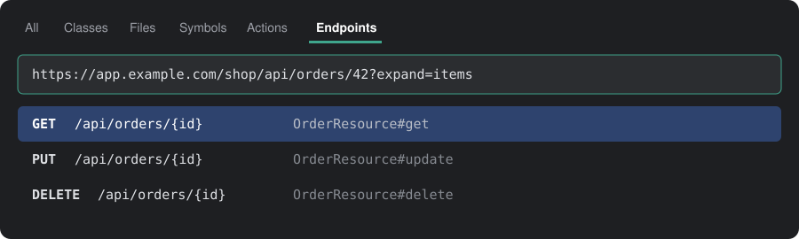
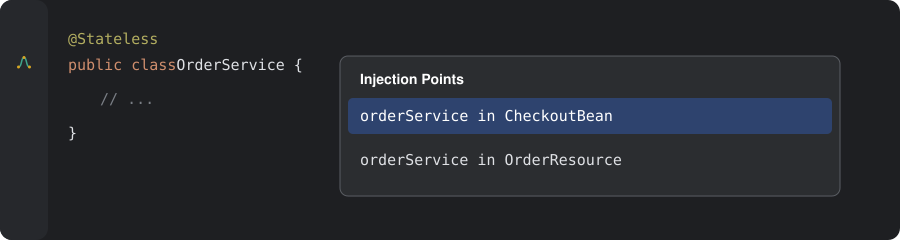
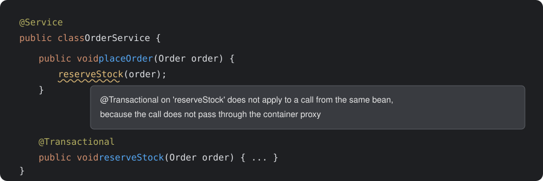

<div align="center">


# Beanline

**URL'yi yapıştır, arkasındaki Java metoduna git.**

Jakarta EE, Java EE ve Spring projeleri için bir IntelliJ IDEA eklentisi.

[](https://github.com/AzizARSLN/beanLine/actions/workflows/build.yml)
[](LICENSE)
[](https://www.jetbrains.com/idea/)
[](https://github.com/AzizARSLN/beanLine/stargazers)

[English](README.md) | **Türkçe**

</div>

Büyük Java projelerinde basit sorular bile zaman alır: Bu URL'ye hangi metot yanıt veriyor, bu bean nereye enjekte
ediliyor, bu `@Transactional` neden çalışmadı? Beanline bu soruları IDE'nin içinde yanıtlar.

Beanline işine yaradıysa bir ⭐ vererek diğer Java geliştiricilerinin de bulmasına yardımcı olabilirsin.

## Özellikler

### Her URL'den endpoint'i bul

Tarayıcının Network sekmesinden, bir log satırından veya hata kaydından aldığın URL'yi Search Everywhere'in
**Endpoints** sekmesine yapıştır ve o isteği karşılayan Java metoduna git.



- Sunucu adresi, context path ve sorgu parametreleri dikkate alınmaz.
- Yol parametreleri her değerle eşleşir. Aradığın metindeki `${id}`, `{{id}}` ve `:id` joker karakter gibi çalışır.
- Sonuçları daraltmak için HTTP metoduyla başla: `POST /api/orders`.
- Üst sınıftan gelen endpoint'ler, somut sınıfın yoluyla bulunur.

**Navigate > Go to Endpoint** (`Ctrl+Alt+Shift+E`), seçili metni, imleçteki metni veya panodaki URL'yi arar. İmleçteki
metin herhangi bir dosyada olabilir, yani önyüz kodunda da çalışır.

### Bean'ler ve enjeksiyon noktaları arasında gezin

Bean sınıfındaki satır kenarı ikonu, sınıfın nereye enjekte edildiğini listeler. Enjekte edilen alandaki ikon ise o
alanı karşılayabilecek bean'leri gösterir.



### Container tuzaklarını yazarken yakala



| Denetim | Neyi bildirir? |
|---|---|
| **Self-invocation bypasses the bean proxy** | Aynı bean içinden yapılan çağrıda `@Transactional`, `@TransactionAttribute`, `@Asynchronous`, `@Async`, önbellek veya yeniden deneme anotasyonunun uygulanmaması |
| **Interception annotation on a method the proxy cannot intercept** | Aynı anotasyonların `private`, `final` veya `static` metotlarda kullanılması |
| **Managed bean created with new** | Enjekte alanları olan bir bean'in `new` ile oluşturulması; bu alanlar `null` kalır |

Her denetimi **Settings > Editor > Inspections > Beanline** altından kapatabilir veya önem derecesini değiştirebilirsin.

Bu sayfadaki görseller eklentinin özelliklerini anlatan çizimlerdir, ekran görüntüsü değildir. Eklentinin arayüzü
İngilizcedir.

## Desteklenenler

- IntelliJ IDEA 2025.3 veya üzeri
- `javax.*` ve `jakarta.*` EJB, CDI ve JAX-RS
- Spring stereotipleri, `@Autowired` ve Spring MVC eşlemeleri

## Sınırlamalar

- Yalnızca Java kaynakları analiz edilir. Kotlin bean'leri ve controller'ları henüz algılanmaz.
- Özel stereotip anotasyonları (örneğin `@Service` ile meta-anotasyonlanmış kendi anotasyonun) tanınmaz.
- Çalışma anında oluşturulan yollar çözülemez. Koşullu bean'ler (`@Profile`, `@Conditional`) var kabul edilir.
- JAX-RS `@ApplicationPath` ve Spring `server.servlet.context-path` okunmaz. URL'ler bunun yerine son kısımlarına göre
  eşleştirilir.

## Kurulum

[Son sürümden](https://github.com/AzizARSLN/beanLine/releases/latest) `beanline-<sürüm>.zip` dosyasını indir. ZIP'i
açmadan **Settings > Plugins > ⚙ > Install Plugin from Disk** ile kur.

## Kaynak koddan derleme

JDK 21 gerekir.

```shell
./gradlew buildPlugin
```

Eklenti ZIP'i `build/distributions` klasörüne yazılır. Korumalı bir IDE'de denemek için `./gradlew runIde` komutunu
çalıştır.

## Geliştirme

```shell
./gradlew test
```

## Yol haritası

- UAST ile Kotlin desteği
- Bir bean metodundan ona ulaşan endpoint'lere kadar etki analizi
- Döngüsel bağımlılık tespiti ve bean grafiği
- Depoda saklanan ekip kuralları

## Katkıda bulunma

Hata bildirimlerine ve pull request'lere açığız. Ayrıntılar için [CONTRIBUTING.md](CONTRIBUTING.md) dosyasına bak.

## Lisans

[MIT](LICENSE)
